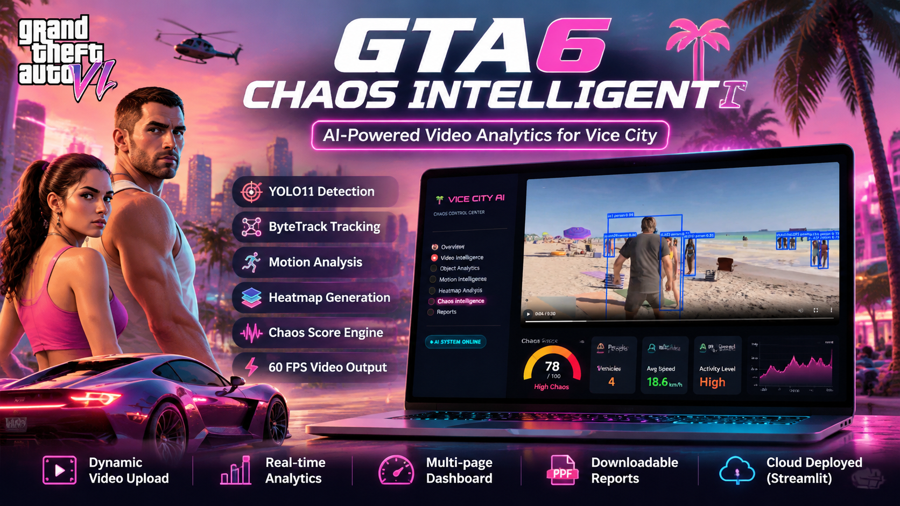
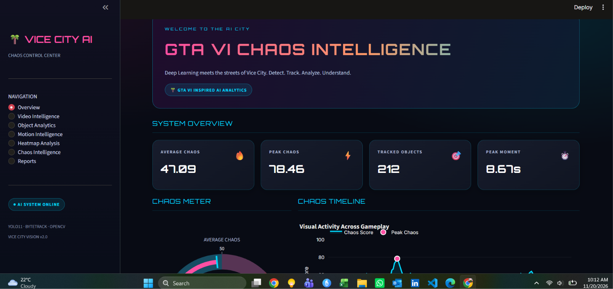
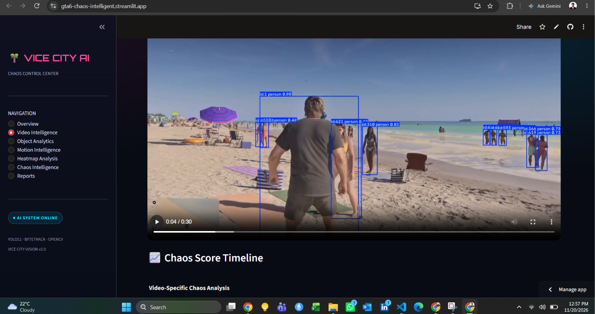
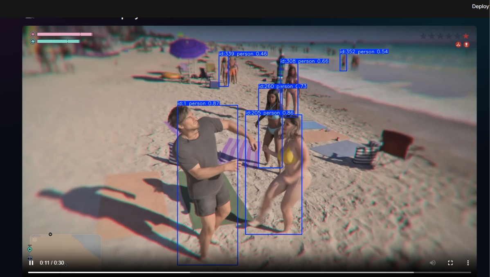
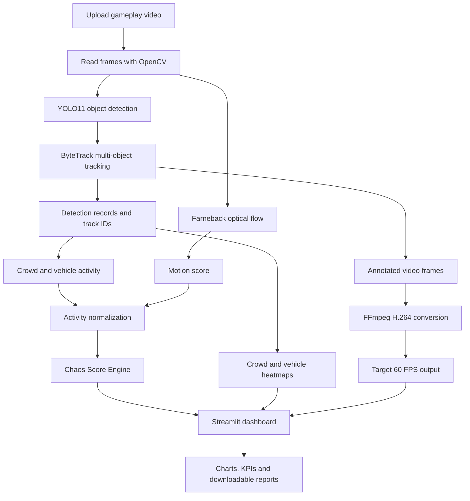

# GTA6 Chaos Intelligent

### AI-Powered Gameplay Video Analytics

**Detect · Track · Analyze · Visualize**

[](https://gta6-chaos-intelligent.streamlit.app/)
[](https://www.python.org/)
[](https://docs.ultralytics.com/)
[](https://opencv.org/)
[](https://streamlit.io/)

[**Launch the live application**](https://gta6-chaos-intelligent.streamlit.app/) · [**View the source code**](https://github.com/srabon-d-costa/GTA6-Chaos-Intelligent)

---

## Overview

**GTA6 Chaos Intelligent** is a Computer Vision and Deep Learning project inspired by the visual world of GTA VI and Vice City. It analyzes uploaded gameplay videos and turns them into structured visual insights.

The application combines **YOLO11 object detection**, **ByteTrack multi-object tracking**, **OpenCV motion analysis**, activity heatmaps, and a custom **Chaos Score Engine**. Results are presented in an interactive Streamlit dashboard with annotated video playback, KPIs, charts, and downloadable analysis files.

The goal is to demonstrate an end-to-end video analytics workflow: from frame-level detection and tracking to activity analysis, visualization, and cloud deployment.

> **Disclaimer:** This is an independent fan-inspired technical project. It is not affiliated with, endorsed by, or sponsored by Rockstar Games or Take-Two Interactive. All related trademarks belong to their respective owners. Use gameplay footage only when you have permission to do so.

## Live Demo

**Application:** [https://gta6-chaos-intelligent.streamlit.app/](https://gta6-chaos-intelligent.streamlit.app/)

For the first test, upload a short gameplay clip. Processing time depends on video length, resolution, and the resources available to the hosted application.

## Application Screenshots

### Main dashboard



### Video intelligence



### Object detection and tracking



## Key Features

| Feature | Description |
|---|---|
| Dynamic video upload | Upload a supported gameplay clip and run a new analysis. |
| YOLO11 object detection | Detect selected people and vehicle-related classes in video frames. |
| ByteTrack tracking | Associate detections across frames and display tracking IDs. |
| Motion intelligence | Estimate frame-to-frame movement using Farneback optical flow. |
| Crowd and vehicle analytics | Calculate activity indicators from detected people and vehicles. |
| Activity heatmaps | Generate crowd and vehicle activity heatmaps in image coordinates. |
| Chaos Score Engine | Combine normalized motion, crowd, vehicle, and scene-complexity indicators into a custom score. |
| Annotated video | Display bounding boxes, class labels, confidence values, and tracking IDs. |
| 60 FPS output target | Use FFmpeg motion-compensated interpolation for smoother playback when the annotated source is below the target frame rate. |
| Interactive dashboard | Explore overview KPIs, object statistics, motion trends, heatmaps, chaos analytics, and reports. |
| Downloadable analysis | Export detection records, activity metrics, chaos scores, peak moments, and a text summary. |

## Dashboard Modules

| Page | Description |
|---|---|
| **Overview** | Average and peak Chaos Score, tracked-object KPIs, chaos gauge, timeline, object distribution, and peak moments. |
| **Video Intelligence** | Upload gameplay, run the dynamic pipeline, view annotated output, and inspect video-specific results. |
| **Object Analytics** | Explore detection records, unique tracked objects, and class-wise statistics. |
| **Motion Intelligence** | Review motion, crowd, and vehicle activity over the video timeline. |
| **Heatmap Analysis** | View crowd-density and vehicle-activity heatmaps. |
| **Chaos Intelligence** | Explore the Chaos Score timeline and chaos-level distribution. |
| **Reports** | Download the generated CSV files and text summary. |

## Technology Stack

| Technology | Role |
|---|---|
| **Python** | Core application and analysis logic |
| **Streamlit** | Interactive web application |
| **Ultralytics YOLO11n** | Object detection |
| **ByteTrack** | Multi-object tracking |
| **OpenCV** | Video decoding, annotation, optical flow, and heatmap generation |
| **NumPy** | Numerical processing |
| **Pandas** | Detection records and activity data |
| **Plotly** | Interactive charts and visualizations |
| **FFmpeg** | H.264 encoding and frame-rate interpolation |
| **imageio-ffmpeg** | FFmpeg executable management |

## Processing Pipeline



### 1. Video ingestion

OpenCV reads the uploaded gameplay video and provides frames to the analysis pipeline. The configured `frame_stride` controls how frequently frames are processed. The current dynamic analysis configuration uses `frame_stride=1` to process every source frame.

### 2. Object detection

YOLO11n detects the selected COCO classes:

| COCO class ID | Object |
|---:|---|
| 0 | Person |
| 1 | Bicycle |
| 2 | Car |
| 3 | Motorcycle |
| 5 | Bus |
| 7 | Truck |

### 3. Multi-object tracking

ByteTrack associates detections between processed frames. Tracking IDs are added to the annotated video and detection records.

### 4. Motion and activity analysis

Farneback optical flow estimates frame-to-frame motion. Detection-derived information is used to calculate crowd and vehicle activity indicators. These indicators are normalized before being used by the Chaos Score Engine.

### 5. Heatmap generation

Detected object locations are accumulated and spatially smoothed to produce crowd and vehicle heatmaps. These visualizations use image coordinates; they are not geographic maps.

### 6. Chaos Score calculation

The project uses a custom weighted composite score:

```text
Chaos Score (raw) =
    0.35 × Motion Score
  + 0.30 × Crowd Score
  + 0.25 × Vehicle Score
  + 0.10 × Scene Complexity Score
```

The raw score is smoothed using a centered rolling mean with a five-sample window and clipped to the 0–100 range.

| Score range | Classification |
|---:|---|
| Below 25 | Low |
| 25 to below 50 | Moderate |
| 50 to below 75 | High |
| 75 to 100 | Very High |

The Chaos Score is a **project-specific gameplay analytics indicator**. It is not a validated measure of real-world danger, crime, or public safety.

## 60 FPS Video Output

The dynamic pipeline targets **60 FPS** for the annotated output video.

When the annotated source is below the target frame rate, FFmpeg's `minterpolate` filter attempts motion-compensated frame interpolation before H.264 encoding.

Important distinctions:

- YOLO11 detections, ByteTrack tracking, motion metrics, heatmaps, and Chaos Scores are calculated from the original processed frames.
- Interpolated frames are generated for smoother playback; they are not additional AI detections.
- Fast motion, occlusion, scene cuts, and overlapping objects can cause interpolation artifacts.
- If interpolation fails, the pipeline may use a standard frame-rate conversion fallback. A 60 FPS file created through frame duplication is not the same as motion-compensated interpolation.
- Processing every source frame and interpolating output can be computationally expensive, especially on CPU-only hosting.

The pipeline reports the verified output frame rate and the conversion mode used.

## Generated Outputs

A completed analysis produces files such as:

```text
analysis/
├── detection_results.csv
├── heatmaps/
│   ├── crowd_heatmap.png
│   └── vehicle_heatmap.png
├── reports/
│   ├── activity_metrics.csv
│   ├── chaos_scores.csv
│   ├── peak_chaos_moments.csv
│   └── chaos_summary.txt
└── videos/
    ├── annotated_raw.mp4
    └── annotated_video_web.mp4
```

The exact output set depends on the pipeline configuration and whether each processing stage completes successfully.

## Getting Started

### Prerequisites

- Python version compatible with the PyTorch and Ultralytics versions in `requirements.txt`.
- Git.
- Internet access on first run if the YOLO11 model weights need to be downloaded.

### 1. Clone the repository

```bash
git clone https://github.com/srabon-d-costa/GTA6-Chaos-Intelligent.git
cd GTA6-Chaos-Intelligent
```

### 2. Install Python dependencies

```bash
python -m pip install -r requirements.txt
```

The repository also includes `packages.txt` for Linux system packages used by the hosted deployment. It is not a pip requirements file.

### 3. Run the application

```bash
python -m streamlit run app.py
```

Open the local URL printed in the terminal, usually:

```text
http://localhost:8501
```

### 4. Analyze a gameplay video

1. Open **Video Intelligence** in the sidebar.
2. Upload an MP4, MOV, or AVI gameplay clip.
3. Select **START AI ANALYSIS**.
4. Wait for detection, tracking, activity analysis, heatmap generation, Chaos Score calculation, and video conversion.
5. Explore the dashboard and download the generated reports.

## Repository Structure

```text
GTA6-Chaos-Intelligent/
├── app.py
├── README.md
├── requirements.txt
├── packages.txt
├── .gitignore
├── assets/
│   ├── Dashboard.png
│   ├── overview.png
│   ├── video-intelligence.png
│   └── detection-overlay.png
├── src/
│   ├── __init__.py
│   ├── dynamic_pipeline.py
│   ├── detect_video.py
│   ├── analyze_activity.py
│   └── chaos_score.py
├── data/
│   └── sample_videos/
└── outputs/
    ├── heatmaps/
    ├── reports/
    ├── videos/
    └── dynamic_uploads/
```

Generated gameplay videos, temporary uploads, and model-weight files should be excluded from Git history using `.gitignore`.

## Deployment

The application is deployed using **Streamlit Community Cloud**.

- `app.py` is the Streamlit entry point.
- `requirements.txt` installs Python dependencies.
- `packages.txt` installs Linux system libraries required by OpenCV.
- Pushing commits to the connected GitHub branch triggers redeployment.

### Cloud resource considerations

Cloud CPU and memory limits can affect inference speed and the maximum practical video length. Start with short clips when testing hosted inference. A dedicated GPU inference service and persistent object storage are potential future improvements for larger workloads.

## Limitations

- Detection quality depends on video resolution, visibility, object size, camera movement, and model performance.
- Tracking IDs may change after occlusion or long detection gaps.
- Optical-flow motion estimates are relative to the analyzed clip and can be affected by camera movement.
- Heatmaps represent accumulated image-coordinate activity, not real-world geographic locations.
- Chaos Scores should be compared with awareness that video content and normalization affect the result.
- Motion-compensated interpolation may create artifacts in fast-moving scenes.
- Uploaded videos and generated artifacts are stored in the app's runtime workspace. Hosted ephemeral storage is not guaranteed to persist across app restarts or instance recycling.

## Responsible Use

This project is intended for educational, portfolio, and entertainment purposes. Analyze only gameplay footage that you own or are authorized to use. The application is not designed for real-world surveillance, identification of individuals, or consequential decisions about people.

## Project Links

- **Live application:** [gta6-chaos-intelligent.streamlit.app](https://gta6-chaos-intelligent.streamlit.app/)
- **GitHub repository:** [srabon-d-costa/GTA6-Chaos-Intelligent](https://github.com/srabon-d-costa/GTA6-Chaos-Intelligent)

---

<div align="center">

**GTA6 Chaos Intelligent**

*Detect. Track. Analyze. Visualize.*

Built with Computer Vision, Deep Learning, and a Vice City-inspired vision.

</div>
