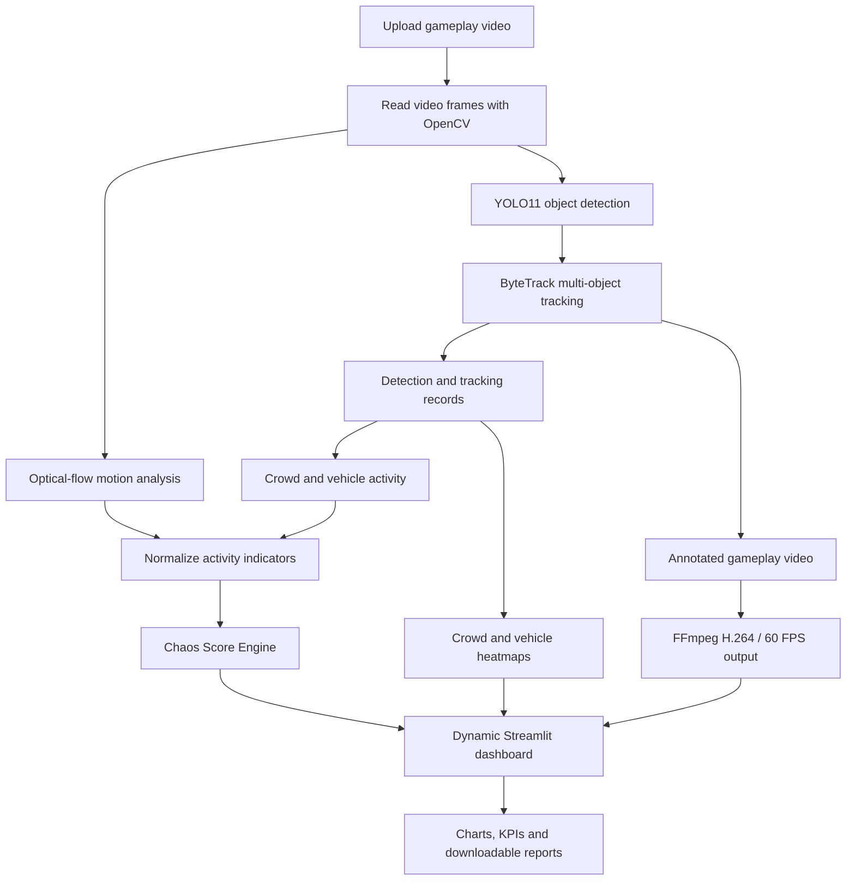

::: {align="center"}
# 🌴 GTA6 Chaos Intelligent

### AI-Powered Gameplay Video Analytics \| Computer Vision · Deep Learning · Multi-Object Tracking

**Turn GTA VI-inspired gameplay footage into an interactive Vice City
intelligence report.**

[](https://www.python.org/)
[](https://streamlit.io/)
[](https://docs.ultralytics.com/)
[](https://opencv.org/)

[**🚀 Live Demo**](https://gta6-chaos-intelligent.streamlit.app/) ·
[**📦 GitHub
Repository**](https://github.com/srabon-d-costa/GTA6-Chaos-Intelligent)
:::

------------------------------------------------------------------------

## Overview

**GTA6 Chaos Intelligent** is a computer-vision project inspired by the
visual world of GTA VI and Vice City. It analyzes uploaded gameplay
videos and transforms the footage into structured visual analytics.

The application combines **YOLO11 object detection**, **ByteTrack
multi-object tracking**, **OpenCV motion analysis**, and a custom
**Chaos Score Engine**. The resulting analysis is presented through a
Streamlit dashboard with video playback, KPIs, interactive charts,
activity heatmaps, and downloadable reports.

> This is an independent fan-inspired technical project. It is not
> affiliated with, endorsed by, or associated with Rockstar Games or
> Take-Two Interactive.

## Highlights

-   **Dynamic video analysis** --- upload a supported gameplay clip and
    generate a new analysis for that video.
-   **Object detection** --- detect people, bicycles, cars, motorcycles,
    buses, and trucks with YOLO11.
-   **Multi-object tracking** --- use ByteTrack to associate detections
    across frames and display tracking IDs.
-   **Motion intelligence** --- estimate frame-to-frame motion using
    optical flow.
-   **Crowd and vehicle analytics** --- summarize detected people and
    vehicles over the clip.
-   **Activity heatmaps** --- visualize the accumulated image locations
    of detected people and vehicles.
-   **Custom Chaos Score** --- combine motion, crowd, vehicle, and
    scene-complexity indicators into a project-specific score.
-   **60 FPS video output** --- use FFmpeg motion-compensated
    interpolation for smoother annotated playback when the source output
    is below the target frame rate.
-   **Interactive dashboard** --- explore Overview, Video Intelligence,
    Object Analytics, Motion Intelligence, Heatmap Analysis, Chaos
    Intelligence, and Reports.
-   **Downloadable outputs** --- export detection records, activity
    metrics, chaos scores, peak moments, and a text summary.

## Demo

Try the deployed application:

### [🌴 Open GTA6 Chaos Intelligent](https://gta6-chaos-intelligent.streamlit.app/)

For the best first test, upload a short gameplay clip (around 10--30
seconds) and start the AI analysis.

> **Demo note:** The hosted application runs within Streamlit Community
> Cloud resource limits. Processing time and the maximum practical video
> length depend on the available CPU, memory, and uploaded video
> resolution.

## Technology Stack

  -----------------------------------------------------------------------
  Area                    Technology              Role
  ----------------------- ----------------------- -----------------------
  Application             Python, Streamlit       Interactive web
                                                  application

  Object detection        Ultralytics YOLO11      Detect objects in video
                                                  frames

  Object tracking         ByteTrack               Associate detections
                                                  across frames

  Image/video processing  OpenCV                  Read frames, annotate
                                                  video, calculate
                                                  optical flow, and
                                                  create heatmaps

  Numerical analysis      NumPy, Pandas           Process detections and
                                                  activity metrics

  Visualization           Plotly                  Interactive charts and
                                                  analytics

  Video conversion        FFmpeg / imageio-ffmpeg H.264 encoding and
                                                  frame interpolation
  -----------------------------------------------------------------------

## System Workflow



## Object Classes

The current detector uses selected COCO classes:

    COCO Class ID Object
  --------------- ------------
                0 Person
                1 Bicycle
                2 Car
                3 Motorcycle
                5 Bus
                7 Truck

The detector uses the `yolo11n.pt` model configuration. Model weights
are managed by Ultralytics and may be downloaded automatically on first
use if they are not already available.

## Chaos Score Method

The project calculates a custom **0--100 Chaos Score** from four
normalized activity indicators:

  Component                    Weight
  ------------------------ ----------
  Motion score                    35%
  Crowd score                     30%
  Vehicle score                   25%
  Scene complexity score          10%
  **Total**                  **100%**

The raw composite score is smoothed with a rolling window to reduce
short-term fluctuations.

The score is designed for **comparative gameplay analytics**. It is a
project-specific indicator, not a validated measure of real-world
danger, crime, or public safety.

## 60 FPS Video Output

The pipeline can process every original frame (`frame_stride=1`) and
generate an annotated H.264 video targeting 60 FPS.

When the annotated source video is below 60 FPS, FFmpeg's `minterpolate`
filter attempts motion-compensated frame interpolation.

Important distinctions:

-   YOLO11 detections, ByteTrack IDs, motion metrics, heatmaps, and
    Chaos Scores are calculated from the original processed frames.
-   Interpolated frames are added for smoother video playback; they are
    not additional AI detections.
-   Fast movement, camera cuts, and overlapping objects can produce
    interpolation artifacts.
-   If motion interpolation fails, the pipeline can fall back to
    standard frame-rate conversion. A 60 FPS file created by duplicating
    frames is not equivalent to true motion-compensated interpolation.

## Dashboard Pages

  ---------------------------------------------------------------------
  Page                               What it shows
  ---------------------------------- ----------------------------------
  **Overview**                       Main KPIs, average and peak chaos,
                                     chaos gauge, timeline, and object
                                     distribution

  **Video Intelligence**             Upload a gameplay video, run the
                                     AI pipeline, view annotated
                                     output, and inspect video-specific
                                     results

  **Object Analytics**               Detection records, unique tracked
                                     objects, and class-wise statistics

  **Motion Intelligence**            Motion, pedestrian, and vehicle
                                     activity trends

  **Heatmap Analysis**               Crowd-density and vehicle-activity
                                     heatmaps

  **Chaos Intelligence**             Chaos score timeline and
                                     chaos-level distribution

  **Reports**                        Download analysis CSV files and
                                     the text summary
  ---------------------------------------------------------------------

After a successful upload analysis, the dashboard uses that video's
generated results for its dynamic analytics during the active
application session. If no new analysis is active, the repository's
bundled sample analysis is used where available.

## Project Structure

``` text
GTA6-Chaos-Intelligent/
│
├── app.py
├── requirements.txt
├── packages.txt
├── README.md
├── .gitignore
│
├── src/
│   ├── __init__.py
│   ├── detect_video.py
│   ├── analyze_activity.py
│   ├── chaos_score.py
│   └── dynamic_pipeline.py
│
├── data/
│   └── sample_videos/
│
└── outputs/
    ├── heatmaps/
    ├── reports/
    ├── videos/
    └── dynamic_uploads/
```

Generated videos, temporary uploads, and model-weight files should
remain outside Git history. The `.gitignore` file excludes these large
or temporary artifacts.

## Run Locally

### 1. Clone the repository

``` bash
git clone https://github.com/srabon-d-costa/GTA6-Chaos-Intelligent.git
cd GTA6-Chaos-Intelligent
```

### 2. Install Python dependencies

``` bash
python -m pip install -r requirements.txt
```

The repository also includes `packages.txt` for Linux system packages
used by the hosted Streamlit deployment. It is not a pip requirements
file.

### 3. Start the Streamlit application

``` bash
python -m streamlit run app.py
```

Open the local URL printed in the terminal, usually:

``` text
http://localhost:8501
```

### 4. Analyze a video

1.  Open **Video Intelligence**.
2.  Upload an MP4, MOV, or AVI gameplay clip.
3.  Select **START AI ANALYSIS**.
4.  Wait for detection, tracking, activity analysis, heatmap generation,
    and video conversion.
5.  Explore the resulting dashboard and download the generated reports.

## Generated Outputs

Each dynamic analysis run creates a dedicated output directory
containing:

``` text
analysis/
├── detection_results.csv
├── heatmaps/
│   ├── crowd_heatmap.png
│   └── vehicle_heatmap.png
├── reports/
│   ├── activity_metrics.csv
│   ├── chaos_scores.csv
│   ├── peak_chaos_moments.csv
│   └── chaos_summary.txt
└── videos/
    ├── annotated_raw.mp4
    └── annotated_video_web.mp4
```

The exact output files depend on the current pipeline configuration and
successful completion of each processing stage.

## Deployment

The project is deployed using **Streamlit Community Cloud**.

Deployment-related files:

-   `requirements.txt` --- Python dependencies.
-   `packages.txt` --- Linux system dependencies needed by OpenCV.
-   `app.py` --- Streamlit entry point.

To update the hosted application, push changes to the repository branch
connected to Streamlit Community Cloud.

**Cloud resource note:** Streamlit Community Cloud does not provide a
guaranteed GPU for this project. YOLO inference and FFmpeg interpolation
may be slower than local processing, and longer or high-resolution
videos may exceed available resources. For larger workloads, a separate
GPU inference service is a potential future improvement.

## Limitations

-   Detection quality depends on video resolution, visibility, camera
    movement, and the selected YOLO model.
-   ByteTrack IDs can change after occlusion or long detection gaps.
-   Heatmaps represent accumulated detection locations in image
    coordinates; they are not geospatial maps.
-   Motion scores are relative to the analyzed clip and depend on frame
    sampling and resolution.
-   Chaos Scores from different clips should be compared with awareness
    that clip content and normalization affect the result.
-   Hosted uploads and generated files may be temporary because the app
    workspace is not a permanent file-storage service.

## Responsible Use

Use gameplay footage that you own or are authorized to analyze. This
application is intended for entertainment, learning, and technical
demonstration. It should not be used to identify real people or make
consequential decisions about individuals.

## Author

**Project:** GTA6 Chaos Intelligent\
**Repository:**
[srabon-d-costa/GTA6-Chaos-Intelligent](https://github.com/srabon-d-costa/GTA6-Chaos-Intelligent)\
**Live application:**
[gta6-chaos-intelligent.streamlit.app](https://gta6-chaos-intelligent.streamlit.app/)

------------------------------------------------------------------------

::: {align="center"}
**🌴 Detect. Track. Analyze. Understand.**

*Built with Computer Vision & Deep Learning.*
:::
