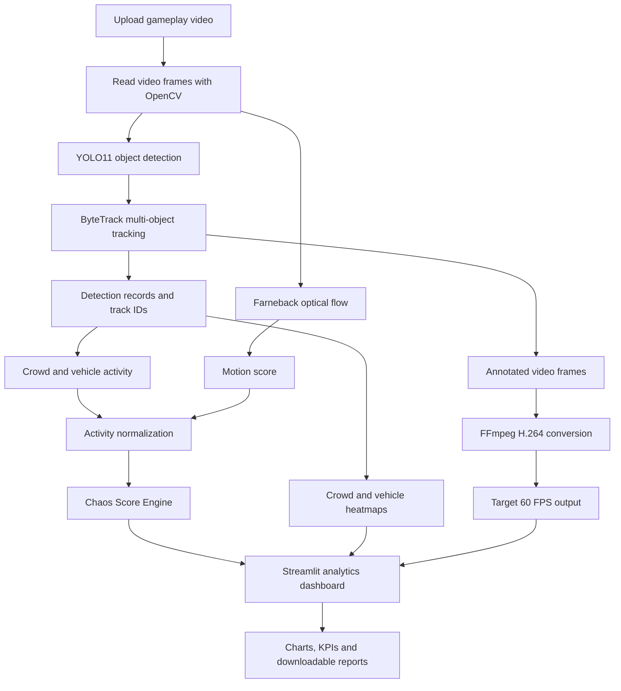

::: {align="center"}
# GTA6 Chaos Intelligent

### AI-Powered Gameplay Video Analytics

**Detect · Track · Analyze · Visualize**

[](https://gta6-chaos-intelligent.streamlit.app/)
[](https://opencv.org/)
[](https://docs.ultralytics.com/)
[](https://github.com/ifzhang/ByteTrack)
[](https://streamlit.io/)

[**Launch the app**](https://gta6-chaos-intelligent.streamlit.app/) ·
[**View source
code**](https://github.com/srabon-d-costa/GTA6-Chaos-Intelligent)
:::

```{=html}
<p align="center">
```
``{=html}
```{=html}
</p>
```

------------------------------------------------------------------------

## Project Overview

**GTA6 Chaos Intelligent** is a Computer Vision and Deep Learning
application inspired by the visual world of GTA VI and Vice City. It
turns gameplay footage into structured video analytics using object
detection, multi-object tracking, motion analysis, activity heatmaps,
and a custom Chaos Score Engine.

Built with **YOLO11, ByteTrack, OpenCV, FFmpeg, Plotly, and Streamlit**,
the application lets users upload a gameplay clip, run an AI analysis
pipeline, inspect annotated video, explore video-specific analytics, and
download generated reports.

The project was developed as a practical demonstration of an end-to-end
computer vision workflow --- from frame-level inference to an
interactive, cloud-deployed analytics dashboard.

> **Disclaimer:** This is an independent fan-inspired technical project.
> It is not affiliated with, endorsed by, or sponsored by Rockstar Games
> or Take-Two Interactive. GTA VI and related marks belong to their
> respective owners. Use gameplay footage only when you have the right
> to use it.

## Live Application

```{=html}
<p align="center">
```
`<a href="https://gta6-chaos-intelligent.streamlit.app/">`{=html}
``{=html}
`</a>`{=html}
```{=html}
</p>
```
**Live URL:** https://gta6-chaos-intelligent.streamlit.app/

For a first run, use a short gameplay clip. Cloud processing time
depends on video resolution, duration, available CPU and memory, and the
current hosting environment.

## Application Preview

### Main dashboard

```{=html}
<p align="center">
```
``{=html}
```{=html}
</p>
```
### Dynamic video intelligence

```{=html}
<p align="center">
```
``{=html}
```{=html}
</p>
```
### Object detection and tracking

```{=html}
<p align="center">
```
``{=html}
```{=html}
</p>
```
## Key Features

  -----------------------------------------------------------------------
  Feature                             Description
  ----------------------------------- -----------------------------------
  Dynamic video upload                Upload a new gameplay clip for an
                                      independent analysis run.

  YOLO11 object detection             Detect selected people and
                                      vehicle-related object classes in
                                      video frames.

  ByteTrack multi-object tracking     Associate detections across frames
                                      and display tracking IDs.

  Motion intelligence                 Estimate frame-to-frame movement
                                      using Farneback optical flow.

  Crowd and vehicle activity          Derive activity indicators from
                                      detected people and selected
                                      vehicle classes.

  Activity heatmaps                   Generate crowd-density and
                                      vehicle-activity heatmaps in image
                                      coordinates.

  Chaos Score Engine                  Combine normalized motion, crowd,
                                      vehicle, and scene-complexity
                                      indicators into a custom score.

  Annotated video output              Render detection boxes, class
                                      labels, confidence scores, and
                                      tracking IDs onto the gameplay
                                      video.

  60 FPS output target                Use FFmpeg motion-compensated
                                      interpolation when the annotated
                                      source is below the requested
                                      output frame rate.

  Interactive dashboard               Explore overview KPIs, object
                                      statistics, motion trends,
                                      heatmaps, chaos analytics, and
                                      reports.

  Downloadable reports                Download generated CSV analysis
                                      files and the text summary.

  Cloud deployment                    Access the Streamlit application
                                      through a public web URL.
  -----------------------------------------------------------------------

## Dashboard Modules

  -----------------------------------------------------------------------
  Dashboard page                      Main information
  ----------------------------------- -----------------------------------
  **Overview**                        Average and peak Chaos Score,
                                      tracked-object KPIs, chaos gauge,
                                      timeline, object distribution, and
                                      peak moments.

  **Video Intelligence**              Upload gameplay, run the dynamic AI
                                      pipeline, view the annotated
                                      output, inspect video-specific
                                      analytics, and download results.

  **Object Analytics**                Detection records, unique tracked
                                      objects, and object-class
                                      distribution.

  **Motion Intelligence**             Motion, crowd, and vehicle activity
                                      trends across the video timeline.

  **Heatmap Analysis**                Crowd-density and vehicle-activity
                                      heatmaps.

  **Chaos Intelligence**              Chaos Score timeline, score gauge,
                                      and chaos-level distribution.

  **Reports**                         Download the generated chaos
                                      scores, activity metrics, detection
                                      results, peak moments, and summary
                                      report.
  -----------------------------------------------------------------------

## Technology Stack

  -----------------------------------------------------------------------
  Technology                          Purpose
  ----------------------------------- -----------------------------------
  **Python**                          Core application and analysis logic

  **Streamlit**                       Interactive web dashboard and
                                      video-upload interface

  **Ultralytics YOLO11n**             Object detection

  **ByteTrack**                       Multi-object tracking

  **OpenCV**                          Video decoding, annotation, optical
                                      flow, and heatmap generation

  **NumPy**                           Numerical operations and score
                                      calculations

  **Pandas**                          Detection records, activity
                                      metrics, and report tables

  **Plotly**                          Interactive charts and dashboard
                                      visualizations

  **FFmpeg**                          H.264 video encoding and frame-rate
                                      conversion/interpolation

  **imageio-ffmpeg**                  FFmpeg executable management
  -----------------------------------------------------------------------

## Processing Pipeline



### 1. Video ingestion

The application accepts a supported gameplay video and reads its frames
using OpenCV. The dynamic pipeline processes frames according to the
configured `frame_stride`.

### 2. Object detection

YOLO11n detects the selected COCO object classes:

    COCO class ID Class
  --------------- ------------
                0 Person
                1 Bicycle
                2 Car
                3 Motorcycle
                5 Bus
                7 Truck

### 3. Multi-object tracking

ByteTrack associates detections across consecutive processed frames. The
annotated output displays object classes, confidence values, and
tracking IDs.

### 4. Motion and activity analysis

Farneback optical flow estimates frame-to-frame motion.
Detection-derived information is used to calculate crowd and vehicle
activity indicators. Activity values are normalized for the custom
scoring stage.

### 5. Heatmap generation

The pipeline accumulates detected object locations and applies spatial
smoothing to generate crowd and vehicle activity heatmaps. These are
image-coordinate visualizations, not geographic maps.

### 6. Chaos Score calculation

The project combines four normalized indicators using the following
weighted formula:

\[ `\text{Chaos Score}`{=tex}\_{raw} = 0.35M + 0.30C + 0.25V + 0.10S \]

Where:

-   \(M\) = normalized motion score
-   \(C\) = normalized crowd score
-   \(V\) = normalized vehicle score
-   \(S\) = normalized scene-complexity score

A centered rolling mean with a five-sample window is applied to smooth
short-term score fluctuations. The final score is clipped to the 0--100
range.

#### Chaos level interpretation

             Score Level
  ---------------- -----------
          Below 25 Low
    25 to below 50 Moderate
    50 to below 75 High
         75 to 100 Very High

The Chaos Score is a **custom gameplay analytics indicator** created for
this project. It is not a validated measure of real-world danger, crime,
or public safety.

## 60 FPS Video Output

The pipeline supports a target output frame rate of **60 FPS**.

When the annotated source video is below the target frame rate, FFmpeg's
`minterpolate` filter attempts motion-compensated frame interpolation
before H.264 encoding.

Important technical details:

-   AI detection, ByteTrack tracking, motion analysis, heatmaps, and
    Chaos Score calculations are based on the original processed frames.
-   Interpolated frames are generated for smoother playback; they are
    not additional YOLO detections.
-   Fast motion, occlusion, scene cuts, and overlapping objects can
    introduce interpolation artifacts.
-   If interpolation fails, the pipeline can use a standard frame-rate
    conversion fallback. A converted 60 FPS file is not necessarily
    equivalent to true motion-compensated interpolation.
-   Processing every original frame and interpolating output can be
    computationally expensive, especially on CPU-only hosting.

The output metadata reports the verified video frame rate and the
conversion mode used for that run.

## Generated Outputs

Each successful dynamic analysis run creates a dedicated output
directory. The pipeline generates files such as:

``` text
analysis/
├── detection_results.csv
├── heatmaps/
│   ├── crowd_heatmap.png
│   └── vehicle_heatmap.png
├── reports/
│   ├── activity_metrics.csv
│   ├── chaos_scores.csv
│   ├── peak_chaos_moments.csv
│   └── chaos_summary.txt
└── videos/
    ├── annotated_raw.mp4
    └── annotated_video_web.mp4
```

The exact files available depend on the selected pipeline version and
whether each processing stage completes successfully.

## Getting Started

### Prerequisites

-   Python installation compatible with the versions of PyTorch and
    Ultralytics listed in `requirements.txt`.
-   Git.
-   FFmpeg support through `imageio-ffmpeg`.
-   Internet access on first run if the YOLO11 model weights need to be
    downloaded.

### 1. Clone the repository

``` bash
git clone https://github.com/srabon-d-costa/GTA6-Chaos-Intelligent.git
cd GTA6-Chaos-Intelligent
```

### 2. Install Python dependencies

``` bash
python -m pip install -r requirements.txt
```

The repository also contains `packages.txt` for Linux system packages
used by the hosted deployment. It is not a pip requirements file.

### 3. Launch the application

``` bash
python -m streamlit run app.py
```

Open the local URL printed by Streamlit, usually:

``` text
http://localhost:8501
```

### 4. Analyze a gameplay clip

1.  Open **Video Intelligence** in the sidebar.
2.  Upload an MP4, MOV, or AVI gameplay video.
3.  Select **START AI ANALYSIS**.
4.  Wait for detection, tracking, motion analysis, heatmap generation,
    Chaos Score calculation, and video conversion.
5.  Explore the dashboard modules and download the generated reports.

## Repository Structure

``` text
GTA6-Chaos-Intelligent/
│
├── app.py
├── README.md
├── requirements.txt
├── packages.txt
├── .gitignore
│
├── assets/
│   ├── Dashboard.png
│   ├── overview.png
│   ├── video-intelligence.png
│   └── detection-overlay.png
│
├── src/
│   ├── __init__.py
│   ├── dynamic_pipeline.py
│   ├── detect_video.py
│   ├── analyze_activity.py
│   └── chaos_score.py
│
├── data/
│   └── sample_videos/
│
└── outputs/
    ├── heatmaps/
    ├── reports/
    ├── videos/
    └── dynamic_uploads/
```

Generated gameplay videos, large model weights, temporary uploads, and
other runtime artifacts should be excluded from Git using `.gitignore`.

## Deployment

The application is deployed on **Streamlit Community Cloud**.

-   `app.py` is the Streamlit entry point.
-   `requirements.txt` installs Python dependencies.
-   `packages.txt` installs Linux system libraries required by OpenCV.
-   Pushing updates to the connected GitHub branch triggers a
    redeployment.

### Cloud resource considerations

The hosted application runs within the CPU and memory limits of its
hosting environment. YOLO inference and motion-compensated video
interpolation can take longer in the cloud than on a local machine.
Begin cloud testing with short, lower-resolution clips before attempting
longer videos.

For larger workloads, a dedicated GPU inference service and persistent
object storage would be appropriate future infrastructure improvements.

## Current Scope and Limitations

-   Detection quality depends on video resolution, visibility, object
    size, camera movement, and the selected model.
-   Tracking identities may change after occlusion or long detection
    gaps.
-   Optical-flow motion estimates are relative to the analyzed clip and
    can be affected by camera movement.
-   Heatmaps show accumulated image-coordinate activity, not real-world
    locations.
-   Chaos Scores are intended for within-project gameplay comparison and
    should be interpreted in the context of the analyzed clip.
-   Motion-compensated interpolation may create visual artifacts in
    fast-moving scenes.
-   Uploaded videos and generated analysis artifacts are stored in the
    application's runtime workspace. Hosted ephemeral storage is not
    guaranteed to persist across app restarts or instance recycling.

## Responsible Use

This project is intended for educational, portfolio, and entertainment
purposes. Analyze only gameplay footage that you own or are authorized
to use. The system is not designed for real-world surveillance,
identification of individuals, or consequential decisions about people.

## Project Links

-   **Live application:** https://gta6-chaos-intelligent.streamlit.app/
-   **GitHub repository:**
    https://github.com/srabon-d-costa/GTA6-Chaos-Intelligent

------------------------------------------------------------------------

::: {align="center"}
### 🌴 GTA6 Chaos Intelligent

**Detect. Track. Analyze. Understand.**

*Built with Computer Vision, Deep Learning, and a Vice City-inspired
vision.*
:::
